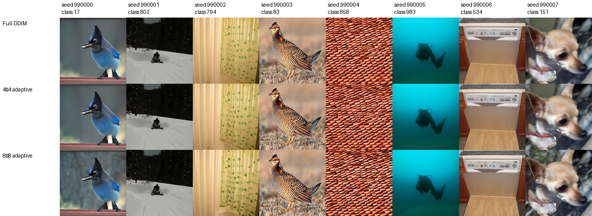

# DiT-XL 4×4 vs. 8×8 adaptive patches at 512×512

Both arms use the official native 512px checkpoint, its original positional grid, DDIM with 50 calls, CFG 4, BF16 denoising, and the same FP32 VAE on NVIDIA B200 MIG 2g.45gb.

Adaptive arms both coarsen the two lowest-scoring 8×8 latent regions on calls 21–38. They use the same 4×4-window scoring rule, checkpoint, and seed/class pairs. The 4×4 arm emits four coarse tokens per selected region and the 8×8 arm emits one.

All three arms were measured together on the same 64 evaluation pairs as the original 512px quality run.

| Arm | Samples | XL calls | LPIPS to full DDIM | Latent MSE | Median denoise s | Median total s | Mean tokens | Approx. transformer GFLOPs |
|---|---:|---:|---:|---:|---:|---:|---:|---:|
| Full DDIM | 64 | 50 | 0.0000 | 0.0000 | 1.456 | 1.504 | 1024.0 | 52447.7 |
| 4×4 adaptive | 64 | 50 | 0.0460 | 0.0141 | 1.403 | 1.452 | 1015.4 | 51949.7 |
| 8×8 adaptive | 64 | 50 | 0.0906 | 0.0264 | 1.394 | 1.443 | 1013.2 | 51825.6 |

LPIPS and latent MSE measure paired agreement with full DDIM.
Total latency includes VAE decoding. The transformer FLOP estimate is per guidance branch and excludes patch projections, selector, residual, and VAE costs.

Columns in the sample grid share starting noise and class. Rows follow the table order.

Raw artifacts are under artifacts/adaptive_512/patch-sweep.

[Official 512px weights](https://dl.fbaipublicfiles.com/DiT/models/DiT-XL-2-512x512.pt)

Human ratings are pending. The blinded images and ballot template are in the raw artifacts' blind folder.
