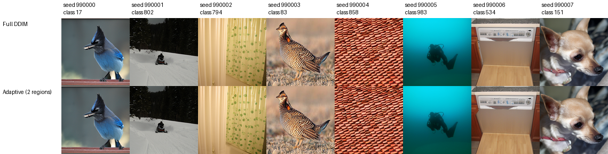
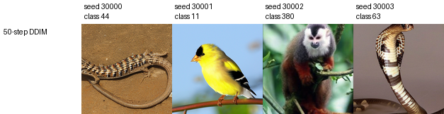

# DiT-XL adaptive patch quality at 512×512

Both arms use the official native 512px checkpoint, its original positional grid, DDIM with 50 calls, CFG 4, BF16 denoising, and the same FP32 VAE on NVIDIA B200 MIG 2g.45gb.

The adaptive arm uses 4×4 latent patches in the lowest-scoring regions on steps 21–38. The other regions and steps use 2×2 patches. The chosen setting was frozen after inspecting the disjoint pilot.

The 50-step reference check used four original seed/class pairs. The pilot used 16 disjoint pairs, and the final run used 64 fresh pairs.

| Arm | Samples | XL calls | LPIPS to full DDIM | Latent MSE | Median denoise s | Median total s | Mean tokens | Approx. transformer GFLOPs |
|---|---:|---:|---:|---:|---:|---:|---:|---:|
| Full DDIM | 64 | 50 | 0.0000 | 0.0000 | 1.449 | 1.498 | 1024.0 | 52447.7 |
| Adaptive (2 regions) | 64 | 50 | 0.0460 | 0.0141 | 1.396 | 1.444 | 1015.4 | 51949.7 |

LPIPS and latent MSE measure paired agreement with full DDIM.
Total latency includes VAE decoding. The transformer FLOP estimate is per guidance branch and excludes patch projections, selector, residual, and VAE costs.

Columns in the sample grid share starting noise and class. Rows follow the table order.

Raw artifacts are under artifacts/adaptive_512/final.

[Official 512px weights](https://dl.fbaipublicfiles.com/DiT/models/DiT-XL-2-512x512.pt)

Human ratings are pending. The blinded images and ballot template are in the raw artifacts' blind folder.

## What the 512×512 comparison shows

This is an inference-only experiment on the official pretrained DiT-XL/2 512×512 checkpoint. The model weights were frozen, with no LoRA or fine-tuning. The full-detail baseline uses 2×2 patches on the 64×64 latent grid, giving 1,024 tokens at every denoising step. The adaptive configuration coarsens two selected regions during the middle 18 of the 50 steps. Both runs make the same number of model calls.

On the 64 held-out seed/class pairs, 4×4 adaptive patching reduced median end-to-end latency from **1.498 s to 1.444 s**, a saving of **54 ms (3.6%)**. Median denoising time fell from **1.449 s to 1.396 s**. Mean tokens per step fell by about **0.8%**, and the estimated transformer FLOPs by about **0.9%**. These are separate measurements: the FLOP estimate covers the transformer for one guidance branch, while end-to-end timing includes the actual sampling path and decoding. The timings describe this batch-one experiment on the B200 MIG slice.

Mean paired LPIPS was **0.0460** and latent MSE was **0.0141** against the corresponding full-detail samples. These metrics measure how much the same-seed output changed. ImageNet FID was not measured, and the blinded human evaluation is pending, so the result is evidence of paired fidelity rather than an equivalence claim about overall image quality.

## Follow-up comparing 4×4 and 8×8 patches

The follow-up timed all three arms together on the same 64 seed/class pairs. Use the full-detail time from this sweep when comparing 4×4 with 8×8.

| Strategy | Median total time | Time saved vs. full detail | Mean tokens/step | Paired LPIPS | Latent MSE |
|---|---:|---:|---:|---:|---:|
| Full-detail DDIM | 1.504 s | — | 1,024.0 | 0.0000 | 0.0000 |
| 4×4 adaptive | 1.452 s | 52 ms (3.5%) | 1,015.4 | 0.0460 | 0.0141 |
| 8×8 adaptive | 1.443 s | 61 ms (4.1%) | 1,013.2 | 0.0906 | 0.0264 |

The 4×4 arm captured **about 85% of the measured time savings** of the 8×8 arm. Going to 8×8 saved another **9 ms** and nearly doubled paired LPIPS. On this small pilot, 4×4 gave the closer match for most of the observed speed gain. The 9 ms difference is a descriptive result from these timings. Its stability across repeated runs was not established.

[Patch-size sweep report](adaptive_512_patch_sizes_report.md) · [Paired samples](adaptive_512_patch_sizes_samples.png) · [Sweep metrics](adaptive_512_patch_sizes.json)

## What this says about H1, H2, and H3

- **H1 — Does mixing patch sizes within a step beat uniform-per-step patching at matched compute?** The run shows that a small amount of spatial mixing can save some time on pretrained DiT-XL at 512×512 while keeping the paired outputs relatively close to full-detail DDIM. The comparison is against full-detail DDIM. A direct H1 test needs a uniform-per-step coarse schedule on the same checkpoint, tuned to the same total sampling compute and run on the same seeds and classes.
- **H2 — Does choosing both where and when to coarsen beat either choice alone?** The tested rule mixes patch sizes across regions and confines coarse patches to the middle of denoising. The result measures that combined rule as a whole. To test whether combining the two choices helps, compare it with a fixed spatial layout and a timestep-only schedule at comparable executed compute. The existing result establishes one modest speed–fidelity tradeoff for the combined rule.
- **H3 — Does the selector identify which regions need fine patches?** The experiment uses the selector's lowest-scoring regions, and the patch-size follow-up shows how much the output changes under stronger coarsening. To isolate the selector, compare its chosen regions with randomized regions at the same patch size, region count, and denoising steps. The proposal's direct test would coarsen one region at a time, measure how much the final image changes, then compare that ranking with the selector's scores. The current run gives no direct ranking or matched-random evidence.

The result advances the project’s efficiency goal by showing a small measured batch-one speed gain on a larger pretrained backbone. Its strongest finding is the 4×4 versus 8×8 tradeoff. The hypothesis tests above require controls the 512 benchmark did not include.
