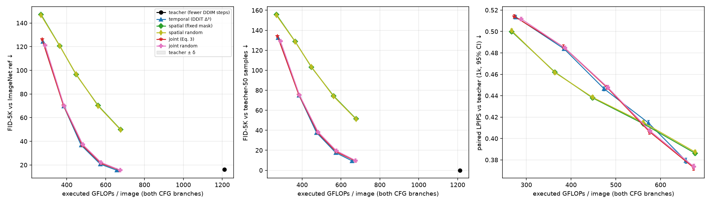

# Shared mixed-patch DiT-S (aggr): H1/H2 sweep

One shared model for every adapted arm. 10000 fresh seeds/arm (FID-10K), first 10,000 paired for LPIPS.
Teacher FID 16.23; no seed-set spread measured in this sweep.

| Arm | τ | Mean tokens/step | Executed GFLOPs/img | FID-5K (ImageNet) | FID vs teacher | LPIPS [95% CI] | Mask turnover |
|---|---:|---:|---:|---:|---:|---|---:|
| joint_random_T130 | 1.24e-03 | 132.0 | 674.7 | 15.68 | 9.74 | 0.3737 [0.3711, 0.3761] | 0.079 |
| joint_T130 | 1.24e-03 | 131.9 | 674.0 | 15.51 | 9.31 | 0.3728 [0.3703, 0.3752] | 0.079 |
| joint_random_T110 | 1.79e-03 | 111.5 | 576.3 | 22.07 | 19.44 | 0.4071 [0.4048, 0.4093] | 0.132 |
| joint_T110 | 1.79e-03 | 111.3 | 575.3 | 21.38 | 18.45 | 0.4063 [0.4040, 0.4085] | 0.132 |
| joint_random_T90 | 2.69e-03 | 91.1 | 482.0 | 37.29 | 38.27 | 0.4477 [0.4457, 0.4497] | 0.125 |
| joint_T90 | 2.69e-03 | 90.7 | 479.9 | 36.63 | 37.52 | 0.4479 [0.4459, 0.4499] | 0.124 |
| joint_random_T70 | 3.69e-03 | 71.6 | 386.0 | 70.08 | 75.29 | 0.4847 [0.4828, 0.4866] | 0.093 |
| joint_T70 | 3.69e-03 | 71.0 | 382.7 | 70.37 | 75.58 | 0.4857 [0.4838, 0.4876] | 0.088 |
| joint_random_T50 | 4.60e-03 | 52.9 | 288.6 | 121.07 | 129.04 | 0.5117 [0.5100, 0.5135] | 0.061 |
| joint_T50 | 4.60e-03 | 50.0 | 272.9 | 126.21 | 134.20 | 0.5142 [0.5124, 0.5159] | 0.053 |
| spatial_T130 | — | 131.9 | 677.4 | 49.90 | 51.44 | 0.3861 [0.3843, 0.3879] | 0.014 |
| spatial_random_T130 | — | 131.9 | 677.4 | 49.60 | 51.08 | 0.3873 [0.3855, 0.3891] | 0.014 |
| spatial_T110 | — | 109.4 | 561.7 | 70.16 | 74.41 | 0.4137 [0.4119, 0.4157] | 0.017 |
| spatial_random_T110 | — | 109.4 | 561.7 | 69.76 | 73.88 | 0.4149 [0.4130, 0.4168] | 0.017 |
| spatial_T90 | — | 86.8 | 447.9 | 96.45 | 103.07 | 0.4380 [0.4361, 0.4399] | 0.019 |
| spatial_random_T90 | — | 86.8 | 447.9 | 96.77 | 103.46 | 0.4385 [0.4366, 0.4404] | 0.019 |
| spatial_T70 | — | 69.9 | 363.9 | 120.65 | 128.77 | 0.4620 [0.4601, 0.4638] | 0.020 |
| spatial_random_T70 | — | 69.9 | 363.9 | 120.52 | 128.60 | 0.4616 [0.4598, 0.4635] | 0.020 |
| spatial_T50 | — | 50.1 | 267.3 | 147.22 | 155.84 | 0.4999 [0.4982, 0.5017] | 0.020 |
| spatial_random_T50 | — | 50.1 | 267.3 | 146.52 | 155.14 | 0.5006 [0.4989, 0.5024] | 0.020 |
| teacher50 | — | 256.0 | 1211.1 | 16.23 | 0.00 | — | 0.000 |
| temporal_T130 | 1.03e-03 | 131.2 | 656.7 | 15.57 | 9.45 | 0.3792 [0.3767, 0.3817] | 0.057 |
| temporal_T110 | 1.56e-03 | 111.1 | 572.7 | 20.65 | 17.58 | 0.4146 [0.4124, 0.4169] | 0.095 |
| temporal_T90 | 2.18e-03 | 90.5 | 473.9 | 36.73 | 37.65 | 0.4464 [0.4444, 0.4484] | 0.140 |
| temporal_T70 | 3.16e-03 | 71.0 | 384.3 | 69.68 | 74.77 | 0.4838 [0.4820, 0.4857] | 0.112 |
| temporal_T50 | 4.10e-03 | 50.4 | 276.5 | 124.30 | 132.43 | 0.5135 [0.5118, 0.5153] | 0.066 |

Executed FLOPs: `torch.utils.flop_counter` on one CFG step (both branches) per token count, including all candidate embeddings/heads, LoRA, attention; quadratic fit max rel. residual 3.5e-14. Selector (Δ³ + window std) adds ~0.1 MFLOP/step, negligible.

Caution: at CFG 4, FID vs ImageNet is non-monotone in fidelity: several adapted arms score *below* the teacher (e.g. 18.1 vs 19.6) while being far from it (FID vs teacher ~10, LPIPS ~0.3). δ is therefore not a usable matched-quality criterion here; use FID vs teacher and paired LPIPS. FID vs teacher for adapted arms uses the same seeds/classes as the teacher reference, so it is not comparable to the teacher seed-set rows (independent seeds, ~11.4 finite-sample floor).

## Paired LPIPS contrasts (same seeds; 95% bootstrap CI of the mean difference)

| Contrast | Δ LPIPS | 95% CI |
|---|---:|---|
| joint_T130 − temporal_T130 | -0.0065 | [-0.0072, -0.0058] |
| spatial_T130 − temporal_T130 | +0.0069 | [+0.0046, +0.0092] |
| joint_T130 − spatial_T130 | -0.0134 | [-0.0157, -0.0111] |
| spatial_T130 − spatial_random_T130 | -0.0012 | [-0.0025, +0.0001] |
| joint_T130 − joint_random_T130 | -0.0009 | [-0.0012, -0.0005] |
| joint_T110 − temporal_T110 | -0.0083 | [-0.0089, -0.0078] |
| spatial_T110 − temporal_T110 | -0.0009 | [-0.0029, +0.0011] |
| joint_T110 − spatial_T110 | -0.0074 | [-0.0095, -0.0054] |
| spatial_T110 − spatial_random_T110 | -0.0012 | [-0.0022, -0.0002] |
| joint_T110 − joint_random_T110 | -0.0008 | [-0.0011, -0.0006] |
| joint_T90 − temporal_T90 | +0.0015 | [+0.0010, +0.0019] |
| spatial_T90 − temporal_T90 | -0.0084 | [-0.0102, -0.0067] |
| joint_T90 − spatial_T90 | +0.0099 | [+0.0082, +0.0117] |
| spatial_T90 − spatial_random_T90 | -0.0005 | [-0.0012, +0.0002] |
| joint_T90 − joint_random_T90 | +0.0002 | [-0.0000, +0.0004] |
| joint_T70 − temporal_T70 | +0.0019 | [+0.0015, +0.0022] |
| spatial_T70 − temporal_T70 | -0.0218 | [-0.0233, -0.0203] |
| joint_T70 − spatial_T70 | +0.0237 | [+0.0221, +0.0251] |
| spatial_T70 − spatial_random_T70 | +0.0004 | [-0.0005, +0.0012] |
| joint_T70 − joint_random_T70 | +0.0010 | [+0.0009, +0.0012] |
| joint_T50 − temporal_T50 | +0.0007 | [+0.0004, +0.0009] |
| spatial_T50 − temporal_T50 | -0.0136 | [-0.0146, -0.0125] |
| joint_T50 − spatial_T50 | +0.0143 | [+0.0132, +0.0153] |
| spatial_T50 − spatial_random_T50 | -0.0007 | [-0.0017, +0.0002] |
| joint_T50 − joint_random_T50 | +0.0024 | [+0.0023, +0.0026] |

Arms at the same target share the calibrated token budget only approximately; compare via the GFLOPs column / Pareto plot.
