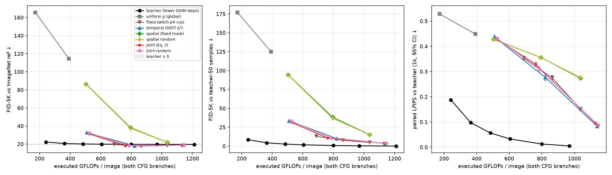

# Shared mixed-patch DiT-S (lora32): H1/H2 sweep

One shared model for every adapted arm. 5000 fresh seeds/arm (FID-5K), first 1,000 paired for LPIPS.
Pre-registered matching tolerance δ = max |FID(teacher-50, seed set r) − FID(teacher-50)| = **0.05** (teacher FID-5K 19.57).

| Arm | τ | Mean tokens/step | Executed GFLOPs/img | FID-5K (ImageNet) | FID vs teacher | LPIPS [95% CI] | Mask turnover |
|---|---:|---:|---:|---:|---:|---|---:|
| joint_random_T200 | 6.17e-04 | 228.1 | 1146.3 | 18.79 | 3.41 | 0.0863 [0.0820, 0.0908] | 0.229 |
| joint_T200 | 6.17e-04 | 225.6 | 1130.2 | 18.82 | 3.67 | 0.0940 [0.0894, 0.0992] | 0.228 |
| joint_random_T150 | 9.55e-04 | 154.9 | 785.0 | 18.23 | 10.74 | 0.3102 [0.3008, 0.3198] | 0.096 |
| joint_T150 | 9.55e-04 | 150.5 | 762.0 | 18.07 | 10.62 | 0.3279 [0.3194, 0.3368] | 0.082 |
| joint_random_T100 | 2.18e-03 | 100.7 | 526.3 | 32.14 | 32.76 | 0.4299 [0.4228, 0.4370] | 0.144 |
| joint_T100 | 2.18e-03 | 100.6 | 525.4 | 31.16 | 31.47 | 0.4287 [0.4217, 0.4359] | 0.144 |
| spatial_T200 | — | 199.6 | 1036.7 | 21.82 | 15.10 | 0.2732 [0.2677, 0.2787] | 0.006 |
| spatial_random_T200 | — | 199.6 | 1036.7 | 21.78 | 14.96 | 0.2759 [0.2705, 0.2813] | 0.006 |
| spatial_T150 | — | 154.5 | 795.2 | 38.14 | 38.30 | 0.3553 [0.3498, 0.3610] | 0.011 |
| spatial_random_T150 | — | 154.5 | 795.2 | 37.49 | 36.87 | 0.3551 [0.3494, 0.3608] | 0.011 |
| spatial_T100 | — | 98.1 | 504.5 | 86.23 | 94.21 | 0.4276 [0.4217, 0.4337] | 0.018 |
| spatial_random_T100 | — | 98.1 | 504.5 | 85.89 | 93.89 | 0.4269 [0.4208, 0.4330] | 0.018 |
| switch4_k10 | — | 217.6 | 1036.8 | 18.44 | 4.80 | 0.1506 [0.1435, 0.1579] | 0.041 |
| switch4_k20 | — | 179.2 | 862.5 | 17.79 | 7.64 | 0.2752 [0.2668, 0.2836] | 0.041 |
| switch4_k30 | — | 140.8 | 688.1 | 19.49 | 13.05 | 0.3525 [0.3448, 0.3604] | 0.041 |
| teacher10 | — | 256.0 | 242.2 | 22.29 | 8.38 | 0.1870 [0.1820, 0.1921] | 0.000 |
| teacher15 | — | 256.0 | 363.3 | 20.56 | 4.26 | 0.0971 [0.0939, 0.1006] | 0.000 |
| teacher20 | — | 256.0 | 484.5 | 20.12 | 2.61 | 0.0560 [0.0536, 0.0583] | 0.000 |
| teacher25 | — | 256.0 | 605.6 | 19.89 | 1.65 | 0.0321 [0.0305, 0.0338] | 0.000 |
| teacher33 | — | 256.0 | 799.3 | 19.73 | 0.73 | 0.0121 [0.0112, 0.0130] | 0.000 |
| teacher40 | — | 256.0 | 968.9 | 19.65 | 0.32 | 0.0045 [0.0040, 0.0050] | 0.000 |
| teacher50 | — | 256.0 | 1211.1 | 19.57 | 0.00 | — | 0.000 |
| teacher50_seedset1 | — | 256.0 | 1211.1 | 19.57 | 11.36 | — | 0.000 |
| teacher50_seedset2 | — | 256.0 | 1211.1 | 19.63 | 11.51 | — | 0.000 |
| temporal_T200 | 5.82e-04 | 228.3 | 1140.3 | 18.80 | 3.32 | 0.0821 [0.0776, 0.0873] | 0.229 |
| temporal_T150 | 7.82e-04 | 165.7 | 822.1 | 18.08 | 9.95 | 0.2758 [0.2649, 0.2861] | 0.120 |
| temporal_T100 | 1.87e-03 | 98.5 | 509.7 | 32.59 | 33.44 | 0.4370 [0.4299, 0.4441] | 0.130 |
| uniform4 | — | 75.5 | 391.8 | 114.56 | 125.12 | 0.4487 [0.4424, 0.4551] | 0.020 |
| uniform8 | — | 30.4 | 172.2 | 165.65 | 177.03 | 0.5286 [0.5227, 0.5345] | 0.020 |

Executed FLOPs: `torch.utils.flop_counter` on one CFG step (both branches) per token count, including all candidate embeddings/heads, LoRA, attention; quadratic fit max rel. residual 3.5e-14. Selector (Δ³ + window std) adds ~0.1 MFLOP/step, negligible.

Caution: at CFG 4, FID vs ImageNet is non-monotone in fidelity: several adapted arms score *below* the teacher (e.g. 18.1 vs 19.6) while being far from it (FID vs teacher ~10, LPIPS ~0.3). δ is therefore not a usable matched-quality criterion here; use FID vs teacher and paired LPIPS. FID vs teacher for adapted arms uses the same seeds/classes as the teacher reference, so it is not comparable to the teacher seed-set rows (independent seeds, ~11.4 finite-sample floor).

## Paired LPIPS contrasts (same seeds; 95% bootstrap CI of the mean difference)

| Contrast | Δ LPIPS | 95% CI |
|---|---:|---|
| joint_T200 − temporal_T200 | +0.0119 | [+0.0094, +0.0145] |
| spatial_T200 − temporal_T200 | +0.1911 | [+0.1859, +0.1967] |
| joint_T200 − spatial_T200 | -0.1792 | [-0.1848, -0.1735] |
| spatial_T200 − spatial_random_T200 | -0.0027 | [-0.0076, +0.0021] |
| joint_T200 − joint_random_T200 | +0.0077 | [+0.0052, +0.0105] |
| joint_T150 − temporal_T150 | +0.0520 | [+0.0449, +0.0598] |
| spatial_T150 − temporal_T150 | +0.0795 | [+0.0693, +0.0902] |
| joint_T150 − spatial_T150 | -0.0275 | [-0.0357, -0.0192] |
| spatial_T150 − spatial_random_T150 | +0.0002 | [-0.0042, +0.0047] |
| joint_T150 − joint_random_T150 | +0.0176 | [+0.0138, +0.0215] |
| joint_T100 − temporal_T100 | -0.0083 | [-0.0099, -0.0066] |
| spatial_T100 − temporal_T100 | -0.0094 | [-0.0154, -0.0035] |
| joint_T100 − spatial_T100 | +0.0011 | [-0.0050, +0.0073] |
| spatial_T100 − spatial_random_T100 | +0.0007 | [-0.0023, +0.0037] |
| joint_T100 − joint_random_T100 | -0.0012 | [-0.0018, -0.0005] |

Arms at the same target share the calibrated token budget only approximately; compare via the GFLOPs column / Pareto plot.

## Allocation gap (RQ3)

Per image, each of 16 blocks is forced to patch size p (others fine) after warmup; damage = LPIPS to the teacher image. Signals are averaged over the teacher's own scheduled steps. gap = (1 − Spearman)/2; 0 perfect, 0.5 uninformative.

| p | Signal | Spearman [95% CI] | Gap |
|---|---|---|---:|
| p8 | fd4 | +0.268 [+0.232, +0.303] | 0.366 |
| p8 | fd8 | +0.311 [+0.275, +0.346] | 0.344 |
| p8 | entropy | +0.281 [+0.245, +0.318] | 0.359 |
| p8 | variation | +0.313 [+0.273, +0.351] | 0.344 |
| p8 | random | -0.015 [-0.049, +0.020] | 0.507 |
| p8 | mean single-block damage | 0.1512 (within-image sd 0.0646) | |
| p4 | fd4 | +0.232 [+0.194, +0.267] | 0.384 |
| p4 | fd8 | +0.242 [+0.201, +0.280] | 0.379 |
| p4 | entropy | +0.239 [+0.197, +0.278] | 0.381 |
| p4 | variation | +0.293 [+0.254, +0.332] | 0.353 |
| p4 | random | -0.008 [-0.040, +0.022] | 0.504 |
| p4 | mean single-block damage | 0.1150 (within-image sd 0.0514) | |

## Measured latency (B200, full 50-step sampling incl. selector; CUDA-synchronized)

| Config | dtype | batch | median s | images/s | speedup vs teacher-50 |
|---|---|---:|---:|---:|---:|
| teacher50 | fp32 | 1 | 0.197 | 5.1 | 1.00× |
| teacher25 | fp32 | 1 | 0.099 | 10.1 | 1.99× |
| uniform4 | fp32 | 1 | 0.328 | 3.0 | 0.60× |
| uniform8 | fp32 | 1 | 0.326 | 3.1 | 0.60× |
| temporal_T200 | fp32 | 1 | 0.238 | 4.2 | 0.83× |
| spatial_T200 | fp32 | 1 | 0.346 | 2.9 | 0.57× |
| joint_T200 | fp32 | 1 | 0.251 | 4.0 | 0.78× |
| temporal_T150 | fp32 | 1 | 0.288 | 3.5 | 0.68× |
| spatial_T150 | fp32 | 1 | 0.347 | 2.9 | 0.57× |
| joint_T150 | fp32 | 1 | 0.290 | 3.5 | 0.68× |
| temporal_T100 | fp32 | 1 | 0.305 | 3.3 | 0.65× |
| spatial_T100 | fp32 | 1 | 0.349 | 2.9 | 0.56× |
| joint_T100 | fp32 | 1 | 0.311 | 3.2 | 0.63× |
| teacher50 | fp32 | 256 | 8.414 | 30.4 | 1.00× |
| teacher25 | fp32 | 256 | 4.209 | 60.8 | 2.00× |
| uniform4 | fp32 | 256 | 3.173 | 80.7 | 2.65× |
| uniform8 | fp32 | 256 | 1.462 | 175.1 | 5.76× |
| temporal_T200 | fp32 | 256 | 9.279 | 27.6 | 0.91× |
| spatial_T200 | fp32 | 256 | 8.192 | 31.3 | 1.03× |
| joint_T200 | fp32 | 256 | 9.333 | 27.4 | 0.90× |
| temporal_T150 | fp32 | 256 | 9.402 | 27.2 | 0.89× |
| spatial_T150 | fp32 | 256 | 6.324 | 40.5 | 1.33× |
| joint_T150 | fp32 | 256 | 9.233 | 27.7 | 0.91× |
| temporal_T100 | fp32 | 256 | 5.014 | 51.1 | 1.68× |
| spatial_T100 | fp32 | 256 | 4.173 | 61.3 | 2.02× |
| joint_T100 | fp32 | 256 | 5.889 | 43.5 | 1.43× |
| teacher50 | bf16 | 1 | 0.249 | 4.0 | 1.00× |
| teacher25 | bf16 | 1 | 0.125 | 8.0 | 2.00× |
| uniform4 | bf16 | 1 | 0.442 | 2.3 | 0.56× |
| uniform8 | bf16 | 1 | 0.439 | 2.3 | 0.57× |
| temporal_T200 | bf16 | 1 | 0.269 | 3.7 | 0.93× |
| spatial_T200 | bf16 | 1 | 0.452 | 2.2 | 0.55× |
| joint_T200 | bf16 | 1 | 0.267 | 3.7 | 0.93× |
| temporal_T150 | bf16 | 1 | 0.269 | 3.7 | 0.93× |
| spatial_T150 | bf16 | 1 | 0.455 | 2.2 | 0.55× |
| joint_T150 | bf16 | 1 | 0.267 | 3.7 | 0.93× |
| temporal_T100 | bf16 | 1 | 0.269 | 3.7 | 0.93× |
| spatial_T100 | bf16 | 1 | 0.456 | 2.2 | 0.55× |
| joint_T100 | bf16 | 1 | 0.269 | 3.7 | 0.93× |
| teacher50 | bf16 | 256 | 1.996 | 128.3 | 1.00× |
| teacher25 | bf16 | 256 | 0.999 | 256.2 | 2.00× |
| uniform4 | bf16 | 256 | 1.470 | 174.2 | 1.36× |
| uniform8 | bf16 | 256 | 0.746 | 343.1 | 2.67× |
| temporal_T200 | bf16 | 256 | 2.016 | 127.0 | 0.99× |
| spatial_T200 | bf16 | 256 | 3.497 | 73.2 | 0.57× |
| joint_T200 | bf16 | 256 | 2.015 | 127.0 | 0.99× |
| temporal_T150 | bf16 | 256 | 2.017 | 126.9 | 0.99× |
| spatial_T150 | bf16 | 256 | 2.778 | 92.2 | 0.72× |
| joint_T150 | bf16 | 256 | 2.015 | 127.0 | 0.99× |
| temporal_T100 | bf16 | 256 | 2.017 | 126.9 | 0.99× |
| spatial_T100 | bf16 | 256 | 1.862 | 137.5 | 1.07× |
| joint_T100 | bf16 | 256 | 2.325 | 110.1 | 0.86× |

Single CFG forward (trunk upper bound on per-step speedup):

| dtype | batch | 256 tok | 160 tok | 64 tok | 16 tok |
|---|---:|---:|---:|---:|---:|
| fp32 | 1 | 3.47 ms | 6.37 ms | 6.33 ms | 6.27 ms |
| fp32 | 256 | 167.92 ms | 133.11 ms | 56.43 ms | 20.01 ms |
| bf16 | 1 | 4.49 ms | 8.61 ms | 8.57 ms | 8.57 ms |
| bf16 | 256 | 39.54 ms | 59.56 ms | 28.36 ms | 12.95 ms |
